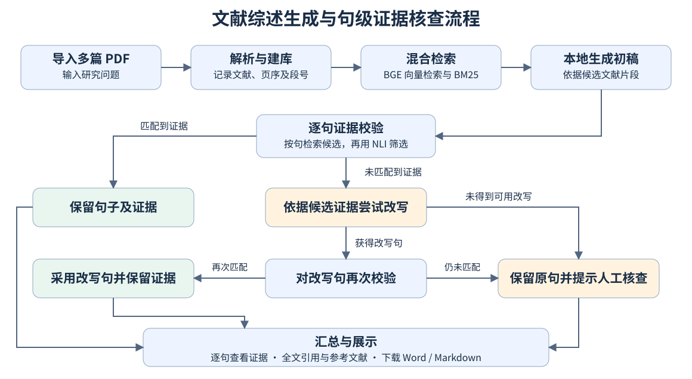

# 面向高校图书馆可验证文献综述生成框架研究

## 一、已取得成果（300字以内）

项目已建成面向高校图书馆的本地文献综述辅助原型，支持上传多篇文本型 PDF、输入研究问题、生成中文综述及查阅句级证据。原型以 5 篇论文、443 个文本段落开展验证，结合向量与关键词检索筛选文献片段。用户可从综述中的引用编号查看对应文献、页码和原文，并下载附参考文献的 Word 或 Markdown。系统对未匹配证据的句子尝试改写并重新校验，仍未匹配时明确提示人工核查。团队已完成 20 条检索查询的标签定稿，形成后续对照评测所需的固定语料与标注集。

## 二、项目进展状况小结

### 1. 项目目标与中期计划完成情况

项目面向高校图书馆的科研服务场景，目标是帮助读者围绕研究问题整理多篇文献，并为生成表述提供可返回原文核查的依据。中期原计划完成多篇文本型 PDF 导入、检索与综述生成、逐句证据匹配和界面展示，并准备真实文献检索评测材料。目前，团队已实现多篇文献从导入到生成、查证和下载的基本流程，完成真实查询标签定稿，已完成正式检索对照评测。

### 2. 多篇文献处理与检索

多篇文献同时导入后，篇内段号可能重复，PDF 文件页序与印刷页码也可能不同。团队在解析阶段保留文献名、PDF 物理页序和篇内段号，用“文献名＋篇内段号”区分证据，并将这些信息传递到检索、展示和导出环节。目前已用 5 篇真实论文、443 个解析段落建立固定语料，用户可以据证据卡片中的文献名和页序返回对应 PDF 查阅。

在检索阶段，关键词检索擅长利用术语重合，向量检索可以捕捉措辞不同但语义相近的表述。系统将 BM25 与 BGE 向量检索的候选排名融合，再把筛选出的材料提供给本地大模型生成综述。团队已完成本地模型配置和 GPU 推理验证。混合检索在本语料上的实际效果，将通过三种模式在同一批查询上的对照实验检验。

### 3. 句级证据核查与原型展示

把检索出的材料交给生成模型后，仍需判断哪些片段支持具体句子。系统对生成结果拆句，为每句重新检索候选段落，再用自然语言推理模型筛选可能支持句子的证据。对未匹配证据的句子，系统尝试依据候选段落改写并再次校验，仍未匹配时保留人工核查提示。项目的阶段性特色是将生成后的句子与可定位的原文片段连接起来，使读者能逐句查看证据，并识别需要继续核查的表述。

在一次真实运行中，团队询问库内证据未直接覆盖的医疗影像应用案例，输出的两句均显示“无命中证据”，命令行也记录了改写处理结果。该案例展示了证据不足时的回退路径。现有界面支持左侧逐句阅读、右侧查看对应证据，并在独立全文区显示引用编号和参考文献，支持下载附参考文献的 Word 或 Markdown。

> **图 2 建议插入位置**　真实生成界面截图。选中一条已人工确认原文能够支持的句子，截图同时展示左侧句子、右侧论文名与页码、证据原文。若同一结果中有未命中句，也可一并截入。

### 4. 正式检索评测与扩写原型进展

团队已为 20 条真实检索查询完成标签定稿，其中开发集 6 条、保留集 14 条，共记录 45 项查询与相关段落的对应关系。语料和标签已通过结构与版本绑定校验，已在固定配置下完成三种检索方式的对照评测。团队还初步跑通了后端结构化扩写原型，可以保留关键句及其证据关联。扩写文本的连贯性仍待验证，前端独立扩写入口尚待接入。

**保留集对照结果。** 使用 6 条开发集查询检查流程并冻结配置，再以同一份 5 篇论文、443 段语料和 14 条保留集查询开展前三位检索评测。

| 检索方式 | Precision@3 | Recall@3 | MRR@3 |
|---|---:|---:|---:|
| BGE 向量 | 0.2619 | 0.4405 | 0.5238 |
| BM25 | 0.4286 | 0.6429 | 0.7738 |
| RRF 混合 | 0.3810 | 0.6071 | 0.7738 |

本次测试中，BM25 的精确率和召回率最高，首个相关结果排名指标与混合检索持平。混合检索三项指标均高于纯向量检索。在一道文献实验分析题（q014）中，两路检索各命中两个相关段落，融合后前三位全部命中。该结果反映本次固定语料与配置下的检索表现，综述句与引用的支持关系仍需人工抽查。

### 5. 技术方案与阶段性创新

（1）**文献解析与混合检索。** 使用 pypdf 提取文本型 PDF 内容，按段保留文献名、PDF 物理页序和篇内段号。查询与段落通过 BAAI/bge-small-zh-v1.5 编码为向量，以余弦相似度衡量语义接近程度，同时用 BM25 检索术语和关键词。系统采用等权倒数排名融合（RRF）合并两路候选，为综述生成提供材料。混合检索在本语料上的表现见本节评测结果。

（2）**本地部署与综述生成。** 生成模型采用 Qwen2.5-7B-Instruct 的 GGUF Q4_K_M 量化版本，由 llama.cpp 提供本地推理服务。团队已在 RTX 5060（8 GB 显存）上验证 CUDA 加速。系统将研究问题和候选文献片段一起交给模型生成中文综述初稿。当前原型的文献处理与模型推理在本机进行，为后续验证高校图书馆本地部署提供基础。

（3）**句级校验与证据约束下的改写。** 对初稿拆句后，系统为每句话重新检索候选段落，以 Erlangshen-RoBERTa-110M-NLI 判断原文是否支持该表述。当前默认保留判定为蕴含且模型分数达到 0.7 的证据，阈值仍需人工样例验证。无命中时，系统尝试依据候选材料改写并再次校验，仍未匹配则提示人工核查。

（4）**阶段性创新。** 项目的贡献是将句级证据核查纳入多文献综述生成和阅读流程。Gradio 界面将句子与候选证据左右对照，用户可依据文献名、页码和原文片段核查具体表述。全文引用编号及来源列表保留在下载结果中。系统同时标出未能匹配证据的句子，帮助读者识别需要继续核查的位置。

## 三、项目今后计划

**结题目标**　完成一套可现场演示的综述辅助系统。用户导入文献后，可以生成综述、逐句核查、查看 PDF 原页证据，并下载保留引用的报告。以检索对照和人工核查两类结果说明系统效果。

1. **第一阶段｜整理评测结果与复验演示。** 汇总三种检索方式的对照结果，分析互补命中与漏检案例。用固定问题复验上传、生成、查证和 Word 下载。
2. **第二阶段｜实现 PDF 原页高亮，完善综述扩写。** 点击证据后显示对应 PDF 原页，并标出证据位置。定位失败时继续提供页码与原文片段。用固定样例验证扩写的连贯性和引用保留情况，验证后接入前端独立扩写入口。同阶段抽样核查生成句，分别统计证据覆盖率和人工判断的证据支持率。
3. **第三阶段｜完成试用与结题交付。** 邀请小范围用户完成综述生成和原文核查任务，记录操作耗时、失败情况及反馈，形成报告、演示视频和答辩材料。核心功能验收后，视进度开展 arXiv 主题检索打样，图书馆资源接口待授权。性能优化依据各环节实际耗时安排。

## 四、经费使用情况和经费安排计划

按原填报表，截至中期累计使用经费 **550 元**，其中计算设备相关支出 200 元，软件及大模型相关支出 300 元，资料打印支出 50 元。

后续经费安排预计 **2500 元**，其中预留服务器租用费 1000 元，用于本地算力不足时补充测试资源。计划安排大模型相关费用 1000 元，用于项目开发与验证，安排材料打印费 500 元，用于校内研讨与成果交流。实际支出按项目需要及学院经费管理要求执行。

## 五、项目存在问题及解决方案

1. **现有综述初稿篇幅较短，尚不足以充分呈现多篇文献之间的联系。** 目前生成阶段优先提炼可核查的关键句，初稿通常能概括主要观点，但对研究背景、不同方法之间的关系及段落衔接展开有限。项目拟采用两阶段生成方案。第一阶段生成并核查关键句，保留其与原文证据的对应关系。第二阶段由综述扩写智能体以这些关键句为基础组织引言、主体和总结，保留原有引用，并区分新增的结构性文字。后端已完成初步试验，下一步将用固定样例检验扩写是否补足内容、改善衔接并保持引用准确，再接入前端独立入口。
2. **综合性表述的句级证据覆盖仍需提升。** 一句话同时比较多种方法或归纳多篇论文时，单一原文片段可能只支持其中一项判断。后续将优先拆分包含多项判断的句子，并通过人工抽查区分候选证据漏检与匹配误判。对于仍未匹配到充分证据的表述，继续保留人工核查提示。
3. **综述引用的证据支持程度仍需量化。** 正式检索对照已完成。下一步抽查综述中的引用，分别统计系统匹配到证据的句子比例，以及人工确认引用支持对应表述的比例。
**4. 系统端到端响应时间仍需测量和优化。** 项目已完成本地大模型的 GPU 加速验证。多篇文献导入后，系统仍需依次完成解析、索引构建、综述生成和句级校验，部分结果还会触发改写与复核。后续将使用固定文献和研究问题，记录首次运行与重复运行的总耗时，并对主要环节分段计时。根据测量结果，优先验证模型复用、索引复用或批量校验等方案的效果。
